# Lyric2TTML

**当前版本：v1.2.1**　·　**WinUI 3 桌面界面**　·　便携包 **414 MB**（解压即用）　·　全程离线、无需 API Key
>
> 🌐 项目主页（GitHub Pages）：https://6hdj.github.io/lrc-ttml/

> ## ⬇️ 下载
>
> **[`Lyric2TTML-winui-v1.2.1-portable.zip`](https://github.com/6hdj/lrc-ttml/releases/download/v1.2.1/Lyric2TTML-winui-v1.2.1-portable.zip)**
> （**414 MB**，解压后双击 `winui\Lyric2TTML.exe`）
>
> 全部版本：[Releases](https://github.com/6hdj/lrc-ttml/releases)　·　
> 旧版 Qt 安装包（v1.1.1，190 MB）：
> [`Lyric2TTML-1.1.1-setup.exe`](https://github.com/6hdj/lrc-ttml/releases/download/v1.1.1/Lyric2TTML-1.1.1-setup.exe)
>
> **首次使用需要联网下两样**（都来自官方源，装完后完全离线可用）：
>
> ① **Whisper 语音模型**（large-v3 约 2.9 GB）——「模型管理」页点下载，
>    走**魔搭 ModelScope 官方源**，实测约 20 MB/s（2 分钟左右）；
> ② **CUDA 运行库**（527 MB）——「运行库」页一键安装，实测 22 秒。
>    需要人声分离时再装 Demucs Worker（约 86 秒）。
>
> ### v1.2 做了什么
>
> * **界面迁移到 WinUI 3**（C# / XAML，原生 Windows 11 风格）：开始 / 歌词工作台 /
>   歌词编辑台 / 任务中心 / 模型管理 / 运行库 / 设置 / 帮助诊断，全部真实页面；
>   浅色·深色·跟随系统主题（选中即预览）、播放逐字高亮。
> * **模型下载改走官方国内源（魔搭 ModelScope）直链**：支持断点续传 + 字节数校验，
>   HuggingFace / GitHub Release 镜像依次兜底；实测 large-v3 2.9 GB ≈ 2 分钟、
>   medium 1.4 GB ≈ 1 分钟、small 464 MB ≈ 30 秒，**7/7 模型可就绪**。
> * **显式保存**：处理完成后先不落盘（`.pending`），点「💾 保存 TTML」才写正式文件；
>   编辑台的修改只进草稿，点保存才写 TTML。未编辑时保存**逐字节保留**生成结果。
>   保存文件名 = **歌手 - 歌名**（同名自动加序号），不再是一串 task id。
> * **便携包不再捆绑 2 GB CUDA**，改为运行库页一键安装 ⇒ 包体从 2.37 GB 降到 **414 MB**。
> * 修掉一批实测问题：后端 CLI 中文乱码、模型「下载」按钮永远灰、
>   深色模式歌词黑字/编辑面板配色、工作台开关文字被裁、
>   外部目录不可写时静默回退、后装 CUDA 不生效等。
>
> ⚠️ **v1.2.0 的附件是「更新补丁」**（只有壳 + 后端 exe，不含后端 `_internal` 运行库），
> 单独运行会报 `Failed to load Python DLL ... python314.dll`。请下载 **v1.2.1 便携版**；
> 更新补丁只用于给已有安装目录覆盖升级。
## 界面演示

> 下面这些是**真实运行的界面截图**（旧版 Qt 桌面窗口 + 浏览器编辑台），不是效果图 ——
> 由 `tools/shoot_screens.ps1` 把服务起起来、用无头浏览器打开真实页面截的，随时可以重新生成。
> 截图用的是仓库自带的示例歌词（[`examples/`](examples/)），里面出现的歌名/歌手都是占位的示例数据。
> **v1.2 的 WinUI 3 界面**截图见下方「WinUI 3 桌面界面」一节。

### WinUI 3 桌面界面（v1.2 新增）

界面全部迁移到 **WinUI 3（C# / XAML）**，左侧八页：
**开始** / **歌词工作台** / **歌词编辑台** / **任务中心** / **模型管理** / **运行库** / **设置** / **帮助诊断**。

* **歌词工作台**：选音频 / 歌词 → 参数 → 开始处理；进度与日志来自后端真实任务，可取消。
* **歌词编辑台**：逐字渲染 + 播放高亮（咬字 / 拖音两阶段）、改时间、±10ms、改声部、
  和声、元数据；改动只写草稿，点「💾 保存 TTML」才写正式文件。
* **模型管理**：7 个模型的来源 / 体积 / 许可 / 真实状态；下载走**魔搭官方源**（断点续传 + 字节校验）。
* **运行库**：torch / CUDA / Demucs Worker 的安装、校验、卸载（装完无需重启即可生效）。
* **设置**：主题（浅色 / 深色 / 跟随系统，选中即预览）、默认参数、歌词保存目录。

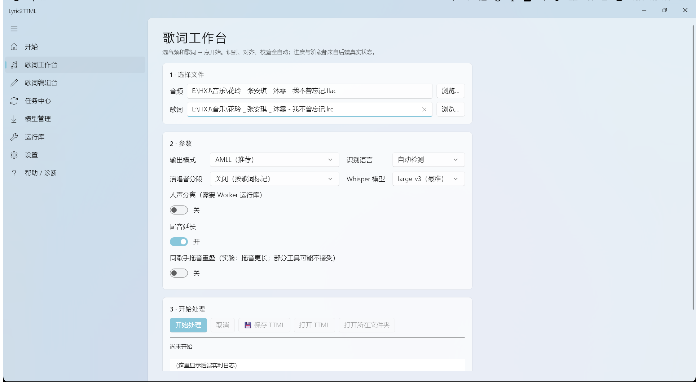

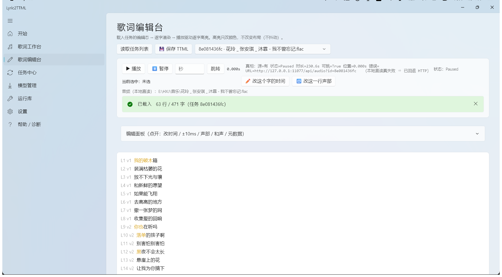

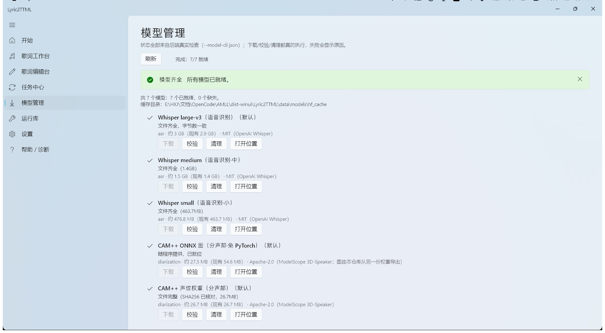

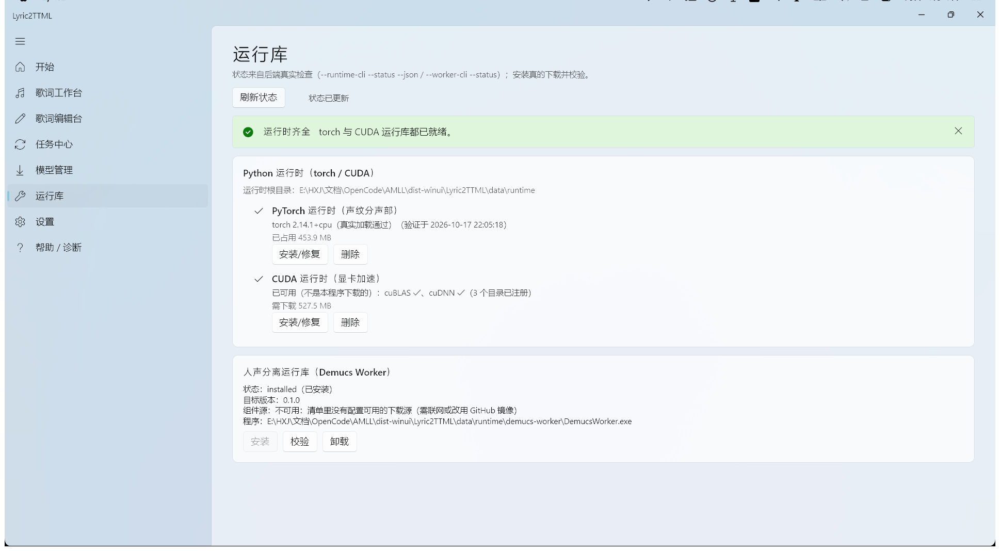

> 上面都是**真实运行的 WinUI 3 界面截图**（后端已启动、编辑台载入了真实任务）。
> 全部 8 页截图在 [`docs/winui/`](docs/winui/)：开始 / 工作台 / 编辑台 / 任务中心 /
> 模型管理 / 运行库 / 设置 / 帮助诊断。

### 旧版 Qt 桌面窗口（v1.1.1，仍可下载）

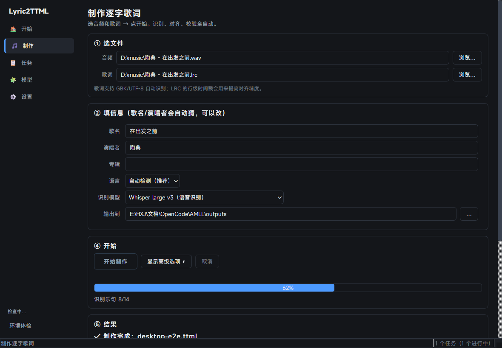

左边五页导航：**开始**（首屏向导）/ **制作** / **任务** / **模型** / **设置**。
转换与下载都在后台跑，界面不卡；进度、日志、取消都在「任务」页。

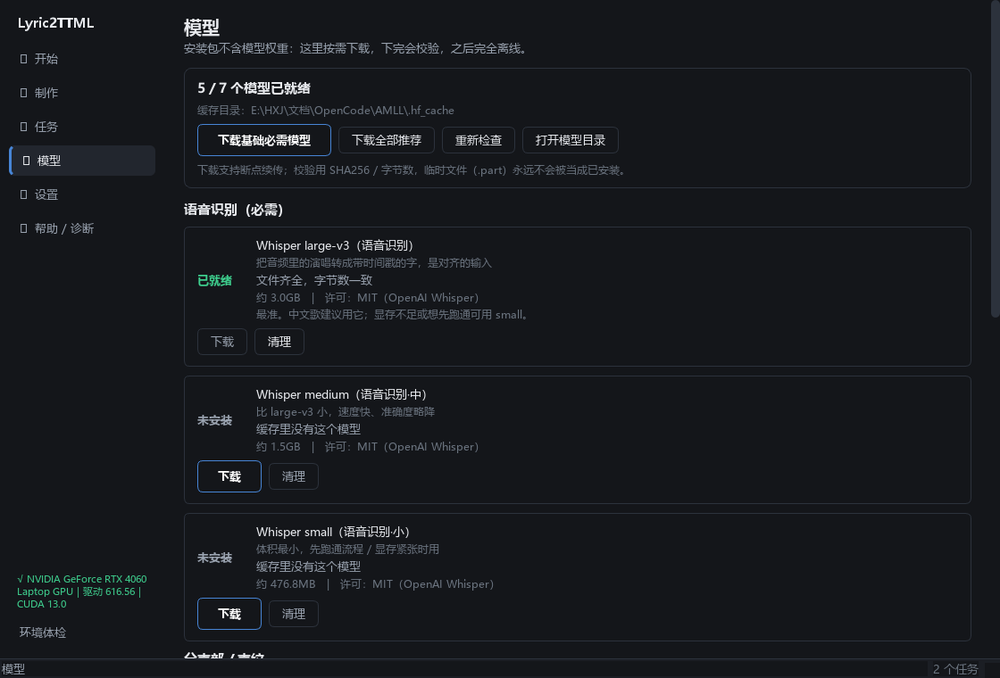

「模型」页是 v1.1 的重点：每个模型的**来源、体积、许可、状态**都摆出来，
状态来自真实校验（文件齐全 + 字节数一致 + SHA256），支持断点续传与单模型清理。

### 1. 上传音频 + 歌词，选参数

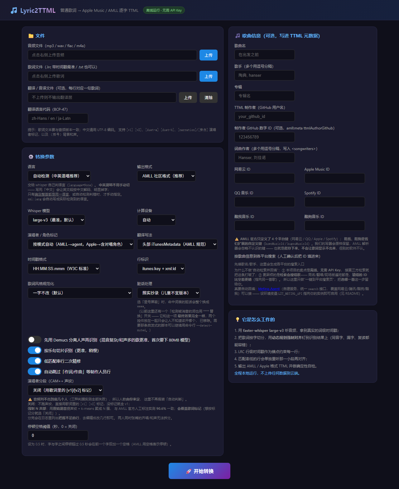

左边放音频 / 歌词 / 翻译文件，右边填歌曲信息，下面一排参数。
**全程本地运行，不上传任何数据。**

### 2. 逐字时间轴：点一下就能改

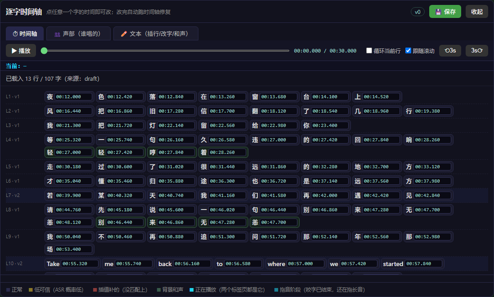

每个字是一个可点的块。**插值补出来的字标红**（那些是 ASR 漏字、由相邻字推算的
时间，最需要人工看一眼），低可信的字标黄，背景和声标绿。

### 3. 分声部：点行号批量改一段

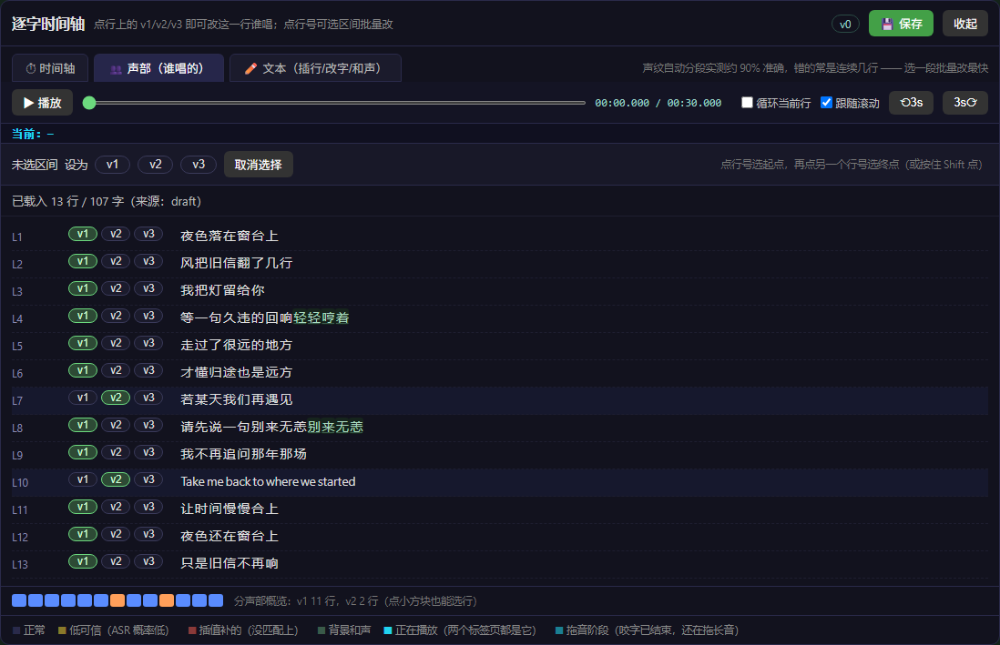

声纹分错的往往**是连续几行**，所以支持"点行号选起点 → 再点终点"批量改。
底部色条一眼看出整首歌谁在唱、怎么交替。

### 4. 文本与和声：歌词缺行、错字在这里补

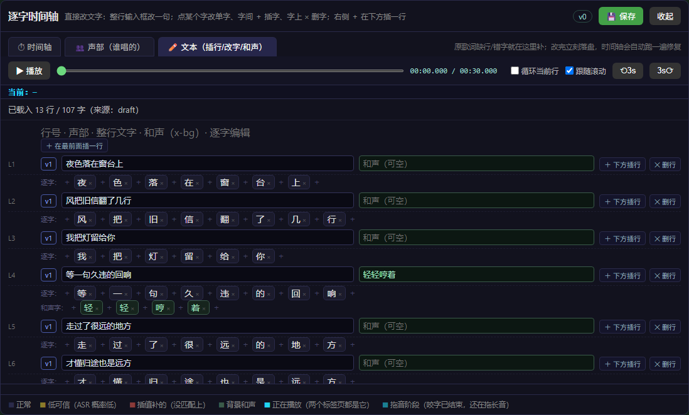

原歌词常缺行、错字；和声虽然自动生成但也会错。这一页可以：
**整行改文字**、**点字改字**、字间 `＋` 插字、字上 `×` 删字、
单独编辑**和声（x-bg）层**，以及在两行之间**插入一行**。

### 5. 窄窗口也能用

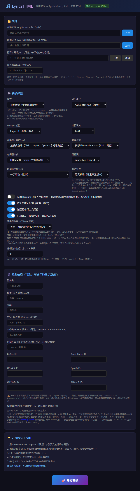

---

## 功能

| 能力 | 说明 |
|------|------|
| 🎧 真实音频对齐 | faster-whisper 识别 + 动态规划强制对齐，逐字时间来自音频而不是"估算" |
| 🀄 中文友好 | 中文按字切分、标点自动归属、同音字/错别字容错（装了 `pypinyin` 更准） |
| 🎼 LRC 锚点 | 有 LRC 行级时间戳时按乐句切片识别，用歌词本身当提示词，精度大幅提升 |
| 🔁 自动精修 | 匹配率偏低的行，单独重听那一小段音频再对齐一次 |
| 🎤 背景人声 | `（和声）` → `<span ttm:role="x-bg">`，半角括号、放在主唱之后 |
| 👥 演唱者对唱 | `[v1] [v2] [duet-a] [duet-b] [narration]` → `ttm:agent`（可选再加 Apple 角色标记） |
| 🌐 翻译 / 音译 | 额外一份文本 → `<iTunesMetadata><translations><text for="L1">`（Apple Music 样式） |
| 📤 双输出格式 | AMLL 社区格式（默认）/ Apple 提交格式（按段落分 `<div itunes:songPart>`） |
| ✅ 确定性自检 | 按 AMLL 规范逐条校验：命名空间、时间格式、行/字重叠、key 连续、元数据必填项 |
| 🪟 WinUI 3 桌面界面 | 原生 Windows 11 风格：工作台 / 编辑台 / 模型 / 运行库 / 任务 / 设置，深浅色主题 |
| 🖥 Web 界面 + 命令行 | 浏览器里上传即用，也可脚本批处理 |

---

## 快速开始

### 两个界面，同一套算法

| 界面 | 怎么开 | 适合 |
| --- | --- | --- |
| **WinUI 3 桌面窗口**（v1.2 起，推荐） | 解压便携包 → `winui\Lyric2TTML.exe` | 日常做歌词 + 精修：工作台 / 编辑台 / 模型 / 运行库 / 任务 / 设置全在这一套里 |
| **浏览器编辑台** | `python web_server.py` | 精修：逐字改时间、改声部、改文本与和声（网页版保底入口） |
| **旧版 Qt 桌面窗口** | v1.1.1 安装包 / `python -m desktop` | 旧安装包用户；功能保留，新特性以 WinUI 版为准 |

WinUI 3 版**内置编辑台**（逐字高亮、时间/声部/和声/元数据编辑、显式保存），
不再需要单独开浏览器；安装包也因此保持轻量。

> ### 桌面窗口的四条设计约束
>
> 1. **模型与安装包分离**：安装包里**不含任何模型权重**，第一次要用的识别模型
>    由程序在「模型」页下载（约 3 GB，支持断点续传）。`READY` 的判据是
>    "文件齐全 + 字节数一致 +（有 SHA256 就核 SHA256）"，不是"下载函数没报错"；
>    半截的 `.part` 永远不会被当成已安装。
> 2. **程序目录 ≠ 数据目录**：配置、日志、输出写 `%LOCALAPPDATA%\Lyric2TTML`
>    （装到 `Program Files` 也能跑）；程序目录里放 `portable.txt` 则全部就地存放。
>    **模型缓存优先复用程序目录下已有的 `.hf_cache`**，老用户升级不用重下 3 GB。
> 3. **耗时操作全在后台**：转换、下载、体检都走任务中心，界面不卡、可取消、
>    可持久化（关了软件再打开，任务历史和日志还在）。
> 4. **产物先写临时文件再原子替换**：转换失败**不会**覆盖上一次做好的文件。

### Windows 便携版安装（推荐，v1.2 起）

> **只需要下一个文件**：
> [`Lyric2TTML-winui-v1.2.1-portable.zip`](https://github.com/6hdj/lrc-ttml/releases/download/v1.2.1/Lyric2TTML-winui-v1.2.1-portable.zip)
> （**414 MB**，解压后双击 `winui\Lyric2TTML.exe`；**不需要管理员权限**）

1. 解压整个 zip（保留 `winui\` 目录结构，**不要只拷 exe**）
2. 双击 `winui\Lyric2TTML.exe` 启动
3. **模型管理 → 下载 Whisper 模型**（魔搭官方源，约 20 MB/s）
4. **运行库 → CUDA 运行时「安装/修复」**（527 MB，腾讯镜像，实测 22 秒）
5. 需要人声分离再装 **运行库 → Demucs Worker**（约 86 秒）
6. 回到「歌词工作台」选音频 + 歌词 → 开始处理；完成后点「💾 保存 TTML」

> **数据放哪**：模型缓存与输出默认在程序目录内（`backend\data` 与 `backend\outputs`）。
> 本机安全策略可能禁止本程序写外部目录；要分目录建议用程序目录内的子目录。

### 旧版 Qt 安装包（v1.1.1，仍可下载）

> **v1.1.x 的安装方式（Qt 桌面版）**：
> [`Lyric2TTML-1.1.1-setup.exe`](https://github.com/6hdj/lrc-ttml/releases/download/v1.1.1/Lyric2TTML-1.1.1-setup.exe)
> （**190 MB**，双击即装）
>
> ⚠️ **不要再照 v1.0.x 的教程做**：旧版要下
> `Lyric2TTML-1.0.3-part1.bin` + `part2.bin`（合计 1.8 GB）再手动跑
> `merge-and-extract-v3.bat` 合并解压 —— **v1.1.0 已经没有这套了**，
> 安装包是单个 exe。

1. 从 [Releases](https://github.com/6hdj/lrc-ttml/releases/latest) 下载
   **`Lyric2TTML-1.1.1-setup.exe`**（190 MB）
2. **双击它** —— **不需要管理员权限、不弹 UAC**
   （默认装到 `%LOCALAPPDATA%\Lyric2TTML`，即当前用户目录）
3. 向导分三步：**选择位置** → **安装** → **完成**
   （可以选安装路径；也可以勾选是否建桌面快捷方式）
4. 装完点「**▶ 启动软件**」直接打开桌面窗口
5. **按「开始」页的引导装两样东西**（各点一下，都有断点续传 + SHA256 校验）：
   * **语音识别模型** `Whisper large-v3`，约 **3 GB**
   * **GPU 运行时（CUDA）**，约 **529 MB** ← v1.1.0 新增的按需下载，见下节
6. 两样都就绪后到「制作」页选音频 + 歌词，点「开始制作」

> ### 关于权限（UAC）
>
> * **默认全程不需要管理员**：安装、快捷方式、卸载注册表项都写在当前用户范围内
>   （`%LOCALAPPDATA%` 与 `HKCU`），程序嵌入的清单是 `asInvoker`。
> * **只有**你把安装路径手动改成 `C:\Program Files\...` 这类系统目录时，
>   写入才会失败 —— 那时请**右键 → 以管理员身份运行**安装程序。
>   （这条路径实测可用，不是"写了就算"。）

> ### 卸载：默认**保留**已下载的模型与运行时
>
> * 卸载入口：**「设置 → 应用」里搜 `Lyric2TTML`**（当前用户的"已安装的应用"），
>   或安装目录里的 `卸载程序.bat`。
> * **默认保留**语音识别模型与 GPU 运行时（合计约 3.5 GB）—— 重装不用重下。
> * 想彻底清干净，卸载程序里有明确的"**同时删除模型与数据**"选项。
> * ⚠️ 搬移**失败时什么都不删**（宁愿卸载不干净，也不让用户白下 3 GB）——
>   它会告诉你怎么手工处理。
> * 卸载**不会**删你自己的输出（`outputs/` 里的 TTML 与工程文件）。

> **安装包里有什么**：Python 运行时、全部依赖库、CAM++ 声纹网络定义、
> 桌面 UI（Qt）。安装程序 **190 MB**。
>
> **需要联网下载两样**（首次使用，各点一下就行，装完永久可用）：
> 语音识别模型（约 3 GB）+ GPU 运行时（约 529 MB）。
> **两样都下完之后完全离线可用。**
>
> ⚠️ 因此 **v1.1.0 首次使用需要联网**（合计约 3.5 GB）。
> 如果环境不能联网，需要"自带 CUDA 运行时的完整版安装包"，
> 请提 issue 说明（构建开关已存在：`L2T_FULL_CUDA=1`，约 717 MB）。

> ### 为什么要单独下「GPU 运行时」（v1.1.0 的变化）
>
> 语音识别**必须用显卡**（CPU 跑一首歌要几分钟，所以没有做 CPU 降级），
> 而显卡加速依赖 NVIDIA 的 cuBLAS —— 其中 `cublasLt64_12.dll`
> **一个文件就 637 MB**。
>
> | | 安装包 | 首次是否要联网 |
> | --- | --- | --- |
> | 打进安装包 | **717 MB** | 否（只需模型） |
> | **按需下载（当前默认）** | **190 MB** | 是（模型 3 GB + 运行时 529 MB） |
>
> 选后者。程序在「开始」页会把这一步列出来；**漏装了也不会静默失败** ——
> 点「开始制作」时会**提前拦住**并告诉你到哪儿装。

> ### 关于 CUDA：仍然**不需要装 CUDA Toolkit**
>
> NVIDIA 驱动自带驱动层（`nvcuda.dll`），足够跑 GPU 推理 ——
> **不需要安装 CUDA Toolkit、不需要 nvcc**。
>
> CTranslate2 另外需要 **cuBLAS**（**不在驱动里**）——
> v1.1.0 把它做成了「运行组件」按需下载，装到
> `%LOCALAPPDATA%\Lyric2TTML\runtime\cuda\bin`。
> 已经装过 `nvidia-cublas-cu12`、或主程序里自带、或系统装过
> CUDA Toolkit 的机器，程序**会直接认出来**，不会让你重复下载。

### 从源码运行（开发 / 想改代码）

```bash
git clone https://github.com/6hdj/lrc-ttml
cd lrc-ttml
python -m venv .venv && .venv\Scripts\activate
pip install -r requirements.txt
python install.py          # 检查并补全缺的东西（推荐）
python web_server.py       # 或直接 python main.py --audio 歌.wav --lyrics 歌.lrc
```

**想要原生桌面窗口**（多装约 350 MB 的 Qt）：

```bash
pip install -r requirements-desktop.txt
python -m desktop                     # 桌面窗口（旧版 Qt）
python desktop/selftest.py            # 服务层自检（离线，14 组）
python desktop/uicheck.py             # 界面自检（无显示环境也能跑，14 项）
```

**构建 WinUI 3 版（v1.2）**：需要 .NET 8 SDK + Windows App SDK（部分环境
`dotnet build` 有 MSB4062，用 VS Build Tools 跑 `pwsh tools/build_winui.ps1`）：

```powershell
# 后端（PyInstaller onedir；完整版含 torch/CUDA，便携版见 docs/WinUI3-版本说明.md）
python -m PyInstaller --noconfirm --onedir --console --name Lyric2TTML.Service `
  --add-data "index.html;." --add-data "desktop/resources;desktop/resources" `
  --add-data "models;models" --collect-all torch --collect-all demucs `
  --hidden-import numpy.core --hidden-import numpy.core.multiarray `
  --hidden-import desktop.services.model_manager --hidden-import doctor `
  service_main.py
pwsh tools/build_winui.ps1        # 构建壳
pwsh tools/deploy_winui.ps1       # 部署到 dist-winui（程序运行时也能在线替换被锁文件）
pwsh tools/publish_models_github.ps1   # 可选：把模型打包上传到 GitHub Release 作备用源
```

**想了解代码结构**：见 [`docs/模块说明.md`](docs/模块说明.md)。那份文档由
`tools/gen_module_docs.py` **从源码自动生成**（职责取自各模块的 docstring，
公开 API 由 AST 解析得出），不是手写的 —— 改了代码重跑一次即可。

### 0. 环境要求

* **Python 3.10+**（开发时用的是 3.14）
* **ffmpeg**（**可选**）—— 多数格式靠内置的 PyAV 就能解，遇到解不开的再装
  * Windows：下载 [ffmpeg](https://www.gyan.dev/ffmpeg/builds/) 解压，把 `bin` 加进 PATH
  * macOS：`brew install ffmpeg`
  * Linux：`sudo apt install ffmpeg`
* **NVIDIA 显卡**：本项目**强制使用 GPU**，没有 CPU 降级（见下文「计算设备」）

### 1. 安装

**Windows 用户**：直接用上面的「一键安装」，不用看这一节。

**源码运行**：

```bash
git clone <你的仓库地址>
cd <仓库目录>

python -m venv .venv
# Windows
.venv\Scripts\activate
# macOS / Linux
source .venv/bin/activate

pip install -r requirements.txt
python install.py          # 检查缺什么、自动补全（推荐先跑一次）
```

> ⚠️ `requirements.txt` 里**钉死了 `av<19` / `ctranslate2<4.9` / `numpy<2.5`**。
> 不要随意升级：`faster_whisper` 调用的 `av.open(..., metadata_errors=...)`
> 在 av 19 里**参数已被移除**，装了新版会在**解码音频时**报
> `TypeError: open() got an unexpected keyword argument 'metadata_errors'`。

首次运行会自动下载 Whisper 模型（`large-v3` 约 3 GB，缓存在 `.hf_cache/`）。
**下过一次之后就能完全离线使用**——这也是本项目的目标形态。

> ### ⚠️ 首次使用必须联网下载模型（最容易卡住的一步）
>
> **模型权重不随仓库/发布包分发**（3 GB，且 GitHub Release 单文件上限 2 GB）。
> 所以第一次转换时会去下载，这一步需要能访问 HuggingFace。
>
> **下载失败时**，程序会明确告诉你是"**模型拿不到**"而不是显卡问题，并给出三条出路：
>
> 1. **联网下载**：确认能访问 `huggingface.co`；国内建议先设镜像
>    ```bash
>    set HF_ENDPOINT=https://hf-mirror.com        # Windows
>    export HF_ENDPOINT=https://hf-mirror.com     # macOS / Linux
>    ```
> 2. **复用已有的模型**（换电脑 / 换目录时最快，不用重新下载）：
>    把别处的 `.hf_cache/models--Systran--faster-whisper-large-v3` 整个目录
>    复制到本目录的 `.hf_cache/` 下。
>    *Windows 上还可以用目录联接，秒完成、不占额外磁盘：*
>    ```cmd
>    mklink /J "新目录\.hf_cache" "旧目录\.hf_cache"
>    ```
> 3. **先用小模型跑通**：界面上「Whisper 模型」选 `small`（~0.5 GB）或
>    `medium`（~1.5 GB），或命令行 `--model small`。精度略低但下载快得多。
>
> 也可以直接指向一个本地模型目录：`--model D:\models\faster-whisper-large-v3`。

> 仓库里自带的 `minipip.py` 是一个**纯内存 wheel 安装器**（不写临时文件、多镜像回退）。
> 只有在 `pip` 被环境限制（企业沙箱、临时目录不可写等）时才需要它：
> ```bash
> python minipip.py install <包名>
> ```

### 2. 启动

```bash
python web_server.py          # 然后打开 http://127.0.0.1:8765
```

Windows 上也可以直接双击 **`启动.bat`**（会优先用 `.venv`，并自动打开浏览器）。

### 3. GPU 加速（自动）

`faster-whisper` 的推理后端是 **ctranslate2**，它不依赖 torch 的 CUDA 支持，
所以即使 torch 是 CPU 版也能用显卡。程序会自动探测：

```
ctranslate2.get_cuda_device_count() > 0  →  device="cuda", compute_type="float16"
```

在一台 RTX 4060 Laptop 上的实测（仅供参考）：

| 项目 | CPU (int8, 20 线程) | GPU (float16) |
|------|-------------------|---------------|
| 12 秒片段识别 | 10.9s | **3.3s** |
| 4:48 整首 ASR | 199s | **28s** |
| 端到端（32 行歌） | 265s | **87s** |

GPU 需要 `cublas64_12.dll` / `cublasLt64_12.dll`。
**v1.1.0 起**它是「运行组件」，按需下载 —— 几种拿到它的方式：

1. **（推荐）程序里点一下**：装好后打开软件，「开始」页或「模型」页里的
   **「运行组件（按需下载）」→ CUDA → 下载并安装**（约 529 MB，
   下完校验 SHA256；命令行等价：`Lyric2TTML.exe --runtime-cli --install cuda`）
2. **完整版安装包**：构建时设 `L2T_FULL_CUDA=1` 打出来的包**自带**它
   （安装包约 717 MB，适合不能联网的机器）
3. **源码运行**：`pip install nvidia-cublas-cu12`（venv 里的那份会被自动认出来）
4. **系统装过 CUDA Toolkit**：也会被自动认出来，不用重复下载
5. （兜底）手动把 DLL 放进 `<数据目录>\runtime\cuda\bin\`

⚠️ **程序会先探测"机器上是不是已经有可用的 cuBLAS"**
（真的 `ctypes.WinDLL` 加载一次，不是看目录在不在），
已有就判"已就绪"，**不会让你白下 529 MB**。

`asr.py` 会自动把这些目录加进 DLL 搜索路径（不用改系统 PATH）。

> ### ⚠️ 本项目**强制使用 GPU**，没有 CPU 降级
>
> 用 CPU 处理一首歌要几分钟，**静默降级只会让人以为"程序就是这么慢"**，
> 根本不知道其实是没用上显卡。所以：
>
> * 设备参数只有 `--device cuda`（默认）和 `--device auto`（等同 cuda），**没有 `cpu`**；
> * 界面上「计算设备」也只有 GPU 两项；
> * 检测不到可用显卡时**直接明确报错**，并列出排查步骤（驱动 / 显卡型号 / CUDA 运行库），
>   而不是偷偷换成 CPU 把活干完。

**性能参考**（同一台机器，RTX 4060 Laptop）：

| 项目 | CPU (int8, 20 线程) | GPU (float16) |
|------|-------------------|---------------|
| 12 秒片段识别 | 10.9s | **3.3s** |
| 4:48 整首 ASR | 199s | **28s** |
| 端到端（32 行歌） | 265s | **87s** |

（CPU 那列只是留档对照，现在的版本不会走 CPU。）

### 3. 两种用法

**命令行：**

```bash
python main.py --audio 歌曲.flac --lyrics 歌曲.lrc --output 歌曲.ttml \
    --title "在出发之前" --artist "陶典" --artist "hanser" \
    --album "崩坏3 Original Soundtrack" --ncm-id 2124643510 --auto-agents
```

**网页界面（推荐给日常使用）：**

```bash
python web_server.py          # 或双击 启动.bat
# 打开 http://127.0.0.1:8765
```

转换完成后点 **✏️ 编辑时间轴** 就能进编辑台，三个模式：

**⏱ 时间轴**：**带播放器**——点任意一个字就跳到那个时间并开始播，正在唱的字和行**实时高亮**，
还有"循环当前行"（反复听一句，调时间时最有用）和 ⟲3s/3s⟳。
改动会**立刻**（节流 300ms）跑一次时间轴修复并提示"已自动修复 N 处"——不是把红色错误丢给你。

**👥 声部（谁唱的）**：自动分声部实测约 90% 准确，剩下的手动收尾。

- 点行上的 `v1` / `v2` / `v3` 就能改这一行谁唱；
- **点行号选起点，再按 Shift 点另一个行号选终点**，然后点 `v1`/`v2` 批量改一整段
  —— 声纹分错的地方通常**连续几行**（实测错误是 L7、L12–L13），所以这是最快的用法；
- **点这一行里的任意一个字**，直接跳到那一刻播放（和「时间轴」里点字一样）；
- 底部色条是**分声部概览**，一眼看出左右交替对不对（点小方块会跳到那一行试听）。

**✏️ 文本（插行/改字/和声）**：原歌词缺行、错字就在这里补。**改完立刻落盘**，不会丢。

- **改一整句**：直接改这一行的输入框，回车或点别处即生效（按原来的时间跨度重新等分）；
- **改一个字**：点那个字 → 就地出现小输入框 → 改完回车；
- **插一个字**：点字与字之间的 `＋` → 输入（可以一次输多个字，会自动拆成逐字）；
- **删一个字**：点字右上角的 `×`；
- **插一行**：点这一行右边的 `＋ 下方插行`，新行落在**上一行结束到下一行开始之间**的空隙里
  （不够就往后占一点，**绝不越过下一行的开始**）；用最上面的
  `＋ 在最前面插一行` 可以插到开头；
- **删一行**：点 `✕ 删行`；
- **和声（背景人声）**：每行右边那个绿色的框就是这一行的 `x-bg`。
  直接改文字即替换和声、清空即删掉和声 —— 和声错了就在这里修。
  下面还会列出**和声逐字**，和主唱一样可以点着改、插、删。

新加的字会按"插值"标红（它确实没有识别证据），提醒你顺手看一眼时间对不对；
时间不对就切回「⏱ 时间轴」拖一下。（说明：`/api/text` 那条路径走的是
"改模型 → 自动修复 → 校验 → 落盘"，所以文字改完格式依然是 0 错误。）

**播放高亮**（两个界面都有，统一用**青色** `#22d3ee`，与状态色蓝/黄/红/绿都能区分）：
正在唱的字是青底 + 青光，正在唱的行左侧一条青色竖边 + 淡青底。

**双人叠唱时会同时亮两处**：v1 拖着长音、v2 已经起唱时，两个声部各自高亮自己的当前字
（播放器读数也会列出来，如 `当前：v1 尽（拖音） · v2 我 · 00:01.800 · …`），
视图跟随会把两行都滚进视野。

**咬字 / 拖音两个阶段**用不同底色区分：一个字的**咬字段**（该行中位字长以内）是实底色 + 描边，
超出部分是**拖音段**，用更淡的底色、不描边——一眼看出"在咬字"还是"在拖长音"，
既体现完整时长，又不跟主进度抢注意力。

**时间轴对齐的两个后处理**（都在流水线里自动跑）：
- **句尾拖音补全**（`--extend-tails`，默认开）：分句时每行的结束会被卡在下一行开始，
  歌手拖长音时尾字会被硬切。用分离人声轨的能量把明显被压扁的尾字接回去
  （实测尾字 <0.25s 的行 49 → 16）。**需要 `--separate-vocals`**，否则自动跳过。
- **同歌手行去重叠**：对齐是按行独立做的，ASR 字时间可能越过下一行开始，
  这会产出**格式错误**的文件。现在会把越界的那一行整行按比例缩放回合法范围。

改完点保存，TTML 和编辑态一起落盘，**重启进程也不会丢进度**（`outputs/<id>.edit.json`）。
保存**只改你改过的东西**：不会动角色、不会重新猜段落名、不会改 agent 类型。

编辑台里颜色含义：灰=正常，黄=ASR 概率低（可信度差），
红=插值补的字（没匹配上，最该手工看一眼），绿=背景和声。

**校验一份已有 TTML（按 AMLL 规范检查）：**

```bash
python main.py --check-only 歌曲.ttml
```

---

## 工作原理

```
音频 + 歌词
   │
   ├─ 1. 解析歌词        LRC 行级时间戳 / 纯文本 / [v1][v2] / （背景人声）
   │
   ├─ 2. 语音识别        faster-whisper large-v3，按乐句切片 + 用该句歌词当提示词
   │
   ├─ 3. 强制对齐        歌词按字切分 ⟷ 识别结果做 Needleman–Wunsch 单调对齐
   │                     同音字→高分；错字→中等分；幻觉词（如 "issippi"）直接丢弃
   │
   ├─ 4. 二次精修        匹配率 < 60% 的行，只重听该行的时间窗再对齐一次
   │
   ├─ 5. 后处理          行窗口收敛、重叠消除、未匹配字插值、时间单调
   │
   └─ 6. 输出 + 自检     生成 TTML（AMLL / Apple），再按规范逐条校验
```

关键点：**大模型不参与时间戳生成**。时间戳全部来自音频，
因此结果可复现、可解释，也不会出现"编造时间轴"的情况。

---

## 输入格式

### LRC（推荐，精度最高）

```
[ti:在出发之前]
[ar:陶典/hanser]
[00:04.37]夜色落在窗台上
[00:08.19]风把旧信翻了几行
[01:10.95]（一路践行）
```

### 纯文本

```
[v1]夜色落在窗台上
[duet-a]风把旧信翻了几行
[duet-b]我一直在等你
[narration]那一年的夏天
有你为我践行(一路践行)
```

* 空行分段（不影响时间轴）
* **演唱者标记**（行首，会被剥离，不进入歌词）：

  | 标记 | `ttm:agent` | Apple 角色（`--markers both/role`） |
  |------|-------------|-----------------------------------|
  | `[v1] [a] [duet-a] [男声]` | `v1` | `x-duet-a` |
  | `[v2] [b] [duet-b] [女声] [对唱]` | `v2` | `x-duet-b` |
  | `[和声] [合唱] [bg]` | `v2` | — |
  | `[narration] [旁白] [独白]` | `v3` | `x-narration` |

* 中文括号 `（）` 或英文括号 `()` 内的内容是背景人声
* 纯文本模式没有行级锚点，时间完全由音频推断，精度略低 → **建议尽量提供 LRC**

---

## 输出格式（AMLL TTML Database 规范）

```xml
<?xml version="1.0" encoding="UTF-8"?>
<tt xmlns="http://www.w3.org/ns/ttml" xmlns:ttm="http://www.w3.org/ns/ttml#metadata"
    xmlns:tts="http://www.w3.org/ns/ttml#styling"
    xmlns:itunes="http://itunes.apple.com/lyric-ttml-extensions"
    xmlns:amll="http://www.example.com/ns/amll"
    xml:lang="zh-Hans" itunes:timing="Word">
  <head>
    <metadata>
      <ttm:agent type="person" xml:id="v1"><ttm:name type="full">陶典</ttm:name></ttm:agent>
      <amll:meta key="musicName" value="在出发之前"/>
      <amll:meta key="artists" value="陶典"/>
      <amll:meta key="album" value="在出发之前"/>
      <amll:meta key="ncmMusicId" value="2124643510"/>
    </metadata>
  </head>
  <body dur="04:48.000">
    <div begin="00:04.370" end="04:14.160">
      <p begin="00:04.370" end="00:07.130" ttm:agent="v1" xml:id="L1" itunes:key="L1"><span begin="00:04.370" end="00:04.490">站</span>…</p>
    </div>
  </body>
</tt>
```

规范要点（程序已逐条实现）：

* **命名空间**：`ttml` / `ttm` / `tts` / `amll`，以及
  `itunes` = `http://music.apple.com/lyric-ttml-internal`（Apple Music 与 AMLL 参考实现
  `packages/ttml` 用的就是它；AMLL 规范文档里写的 `itunes.apple.com/lyric-ttml-extensions`
  解析器同样接受，本程序的校验器两种都认）
* **UTF-8 无 BOM**；`<p>` 内部不换行（span 之间的换行空白会被解析器丢弃）
* **时间戳**（W3C TTML1 §10.3.1）：`clock-time` 是 `hours ":" minutes ":" seconds ( fraction | ":" frames )?`，
  **小时段不可省略**；`offset-time` 必须带单位（`12.5s` / `250ms`）。默认输出 `HH:MM:SS.mmm`；
  AMLL 规范额外容忍 `MM:SS.mmm` 与裸秒 `SS.mmm`，但二者**不是合法 TTML1**，
  仅在 `--time-format mmss|seconds` 时才会使用（自检会降级为警告）
* **`<p>`** 必须带 `ttm:agent`（单人歌也要有 `v1`）与 `itunes:key`（`L1` 起连续递增，跨 div 不断号）
* **`ttm:agent` type**：`person` / `group`(v1000) / `other`(v2000)
* **`amll:meta`**：`musicName` / `artists` / `album` 必填（未给专辑时自动用歌名），另需至少一个平台 ID
* **背景人声**：`<span ttm:role="x-bg">`，半角括号、包住逐字 span、放在主唱之后
* **翻译 / 音译**：默认写进 `<head><iTunesMetadata><translations><translation type="subtitle"><text for="L1">`；
  也可用 `--translation-style inline` 写成行内 `<span ttm:role="x-translation">`
* **段落**：`--mode apple` 会按静默间隔切 `<div itunes:songPart="Verse|Chorus">`

### 尚未实现 / 需要人工的部分

* **多人演唱的自动分声部**：见下一节，目前只能做到"按音色强行聚类"，不可靠
* **Ruby 注音**（`tts:ruby="container|base|textContainer|text"`）：需要额外的注音数据源，程序不生成
* **逐字翻译**（`<text for="L1"><span begin…>`）：目前只做逐行翻译，逐字翻译需要单独对齐
* **段落名**：自动切出来的 `Verse/Chorus` 只是按停顿猜的，正式提交前建议人工确认

---

## Apple 歌词风格准则符合情况

对照《风格标准和准则 · 歌词准则》逐条实现。**默认不改动歌词原文**；
需要按准则规范化时用 `--style apple`，且所有改动都会逐条列出来。

| Apple 准则 | 工具的处理 | 怎么开 |
|-----------|-----------|--------|
| 每句歌词之间换行 | 每句一个 `<p>` | 默认 |
| 唱段之间分段 | 源歌词的**空行**决定 `<div>` 分段，重复段落标 `Chorus`、其余 `Verse`；没写空行时按间奏停顿切分（但不猜段落名） | 默认 |
| 背景人声单独一行、放在主唱下一行 | 在 TTML 里表示为**同一 `<p>` 内的独立 `x-bg` 层**（`preprocess.merge_background_lines` 会把整行和声并进相邻主唱行；包装层带 `begin`/`end`，和声在主唱之前唱时整层排在主唱 span 前面）。⚠️ 不能真写成独立 `<p>`：AMLL 解析器遇到整行只有 `x-bg` 时会当空行丢掉，播放器里看不见（AGENTS.md 铁律 #8） | 自动 |
| 行尾不得用句号或逗号 | 去掉行尾 `.,。，`，保留 `! ? "` | `--style apple` |
| 英文每行首词首字母大写；括号内首词大写 | 只做大写、不做小写（不破坏 NASA / iPhone） | `--style apple` |
| 重复歌词必须完整写出 | 逐行处理，不会折叠重复段落 | 默认 |
| 消音屏蔽的词用星号替换 | 检测「该字时间窗里既没能量也没基频」→ 换成 `****`（Apple 示例就是 4 个星号） | `--detect-muted` |
| 儿童适宜版本屏蔽脏话 | 内置中英文屏蔽词表，替换为 `****` | `--explicit-policy mask` |
| 儿童不宜版本照实抄录 | 默认行为，一字不改 | 默认 |
| 滚动歌词必须与音频版本匹配 | 工具前提就是「这首歌的音频 + 对应歌词」 | — |
| 口述/对话无需抄录 | 不自动判断；LRC 里这类行会被「开头完全没对上」规则当信息行跳过 | 默认开 |

### 明确做不到、需要人工的

* **专有名词 / 品牌名 / 地理名 / 作品名 / 神与宗教相关大写**：需要语义理解，不做自动改动
* **无实际词汇含义的人声**（`ooh` / `ah` 该录、scatting 衬词不该录）：需要人工判断
* **电脑生成的音效**（关门声、喇叭声）：不从音频里发明歌词
* **印度语系的拉丁转写**：没有转写引擎，不做

### 检查会被打进自检结果

`ttml_check.py` 会按准则给出**警告**（不阻断）：行尾标点、英文大小写、括号内首词未大写、
含屏蔽词提示。命令行跑完或 `--check-only` 都能看到。

---

## 多人演唱（分声部 / 分人歌词）

### 自动分声部：CAM++ 声纹模型（`--singer-mode`）

程序内置 **CAM++ 中文说话人声纹模型**
（ModelScope [`iic/speech_campplus_sv_zh-cn_16k-common`](https://modelscope.cn/models/iic/speech_campplus_sv_zh-cn_16k-common)，
权重 27MB 已放在 `models/campplus/`，推理只用 torch，不需要额外依赖）：

```
音频 → 每行取多个 1.5s 窗口的 192 维声纹 → 平均
     → 平均连接层次聚类（阈值 0.35）→ 每行一个 ttm:agent
```

阈值是**实测标定**的，不是拍的：

| 场景 | 余弦相似度 |
|------|-----------|
| 同一个人不同段落（官方示例 1_a vs 1_b） | **0.607** |
| 同一个人整首歌不同乐句（49 行两两平均） | **0.575** |
| 两个不同的人（官方示例 1_a vs 2_a） | **0.013** |
| 模拟对唱（原声 / 降 5 个半音）同人 / 异人 | 0.704 / **0.288** |
| 模拟对唱（原声 / 降 9 个半音）同人 / 异人 | 0.747 / **0.190** |

所以 **0.35** 这条线两边都有余量：同一人在 0.57 以上，不同人在 0.29 以下。

验收结果（`selftest.py` + 真实歌声）：

| 用例 | 结果 |
|------|------|
| 同一个人 4 段音频 | 判定 1 个声部 ✓ |
| 两个人交替 A/B/A/B | 判定 2 个声部，分组 100% 正确 ✓ |
| 真实单人歌《它像一颗》41 行 | 判定 1 个声部，**不会硬拆** ✓ |
| 真实歌伪造对唱（降 5 半音，12 行） | 2 个声部，**逐行 100% 正确** ✓ |
| 真实歌伪造对唱（降 9 半音，12 行） | 2 个声部，**逐行 100% 正确** ✓ |

用法（**人数由你来定** —— 音频判不出到底几个人，见下）：

```bash
# 关闭声纹：直接用歌词里的 [v1]/[v2] 标记（最可靠）
python main.py --audio 歌.wav --lyrics 歌.lrc --singer-mode off

# 已知是两个人 → 强制双声部
python main.py --audio 歌.wav --lyrics 歌.lrc --singer-mode 2

# 三个人 → 强制三声部（比如一人主唱 + 两人轮唱）
python main.py --audio 歌.wav --lyrics 歌.lrc --singer-mode 3
```

网页界面里对应「演唱者分段（CAM++ 声纹）」下拉：**关闭 / 强制单声部 / 强制双声部 / 强制三声部**。

**为什么没有"自动判断人数"**：实测三种判据（平均连接阈值扫描、聚类质量 gap/silhouette、
成对相似度 BIC 双峰检验）**全部失败** —— 最离谱的是"分离质量"指标在**单人歌**上
强判 2 簇的得分反而比真对唱还高（+0.254 vs +0.127），BIC 检验更是真对唱判 1 个成分、
单人歌判 2 个成分（完全反了）。所以这里不再假装能自动数人：

| 选项 | 行为 |
| --- | --- |
| **关闭**（默认） | 不跑声纹，直接用歌词里的 `[v1]/[v2]` 标记；没标记就全 v1 |
| **强制单声部** | 全曲 `ttm:agent="v1"` |
| **强制双声部** | CAM++ 声纹聚成 2 簇，与 AMLL 官方人工标注实测 **90.6%** 一致 |
| **强制三声部** | 聚成 3 簇（一人主唱 + 两人轮唱这种编配） |

强制 N **会覆盖歌词标记**（"强制"就是强制）—— 想按标记分就选「关闭」。
覆盖时日志里会明说一句，不会让你以为标记丢了。

`--auto-agents` / `--split-singers` 仍可用，是**旧参数**（等价于 `--singer-mode 2` / `N`）。

### 手写标记优先

歌词里写了 `[v1] [v2] [duet-a] [duet-b] [narration]` 时，**以手写标记为准**，
自动分段会被跳过；两种方式可以混用（不确定的地方标一下即可）。

### 仍然做不到的

* **两个人同时张嘴的齐唱 / 和声堆叠**——一行里混了两个声纹。声纹模型只能给出"这一行像谁"，
  要把交叠的人声拆开需要**声源分离**（Demucs 之类），不是声纹能解决的。
* **声纹极其接近的两位歌手**（同性别、同音域、同样演唱习惯）——相似度会高于阈值而被并成一个人。
* **行内换人**（同一句里两个人各唱半句）——目前按行给 agent，行内不切分。

如果以后要替换成别的模型（pyannote / WeSpeaker / 3D-Speaker），
只要实现 `diarize(audio, spans, n_singers) -> 每行歌手编号` 这一个接口，
其余流水线无需改动。

---

## 人声分离（Demucs，`--separate-vocals`）

用 **Demucs htdemucs** 先把伴奏剥掉，只留人声，然后**识别和声纹都跑在干净的人声轨上**。
第一次运行会自动下载 80MB 权重到 `models/demucs/`，之后离线可用。

### 实测收益（两首真实歌曲，同一台机器）

| 歌曲 | 原轨 | 仅分离 | **分离 + 双轨复核** |
|------|------|--------|-------------------|
| 在出发之前（4:48，陶典/hanser） | 94.0% | 95.5% | **97.4%** |
| 它像一颗（5:15，Hanser） | 98.1% | 97.2% | **100.0%** |

中间那个"仅分离"很关键：**分离不是万能的**——它把《在出发之前》的
`（想要传达）`（50%→100%）、`因为你一直在`（83%→100%）救回来了，
但让《它像一颗》里 3 行反而变差。所以我加了**双轨复核**：

> 开启分离后，精修阈值自动提到 0.95 —— 只要某一行不是近乎满分，
> **人声轨和原始混音都会重新识别一遍，取匹配率更高的那个**。
> 日志里会写「其中 N 行改用原始混音更准」。

其它可观测的改善（《在出发之前》）：

| 指标 | 原轨 | 分离 |
|------|------|------|
| 对齐阶段匹配率 | 89.8% | 94.7% |
| 需要精修的弱行 | 6 行 | 3 行 |
| CAM++ 簇内相似度（越高质量越好） | 0.53 | 0.58 |
| 校验警告 | 5 | 1 |
| 端到端耗时 | 36s | 33~44s（分离结果会缓存复用） |

### 速度

Demucs 在 GPU 上是 **11× 实时**（60 秒音频 5.4 秒，峰值显存 0.54GB），
一首 5 分钟的歌约 15 秒；CPU 上只有 0.78× 实时（一首歌 6 分钟），**所以强烈建议开 GPU**。

分离结果缓存在 `outputs/<歌名>.<demucs模型>.vocals.wav`，同一首歌、同一个模型重复跑会直接复用；
**换 `--demucs-model` 会用另一个缓存文件**（不会拿旧模型的产物冒充新模型的结果）。
想重新分离就删掉对应的 `outputs/*.vocals.wav`。

### 它解决不了什么

* **两个歌手同时张嘴**：Demucs 只分离"人声 / 伴奏"，不分离"歌手 A / 歌手 B"。
  人声轨里两个人还是混在一起（但至少不再被伴奏染色，声纹判断会更稳）。
  要真正拆开需要**歌手分离模型**（UVR 的 karaoke 系列、MelBand-Roformer 等）。
* 分离本身会引入轻微伪影，个别行反而更差 —— 这也是双轨复核存在的原因。

### 换模型

`--demucs-model` 可选 `htdemucs`（默认，速度/质量平衡）、`htdemucs_ft`（更准但慢约 4 倍）、
`htdemucs_6s`（六分轨）、`mdx_extra`。

---

## 命令行参数

| 参数 | 说明 | 默认 |
|------|------|------|
| `--audio, -a` | 音频文件（mp3/wav/flac/m4a…） | 必填 |
| `--lyrics, -l` | 歌词文件（.lrc / .txt，UTF-8） | 必填 |
| `--output, -o` | 输出 TTML 路径 | 与歌词同名 `.ttml` |
| `--mode, -m` | `amll` / `apple` | `amll` |
| `--language` | `zh` / `en` / `ja` / `ko` | `zh` |
| `--model` | whisper 模型（`tiny`…`large-v3`） | `large-v3` |
| `--device` | `auto` / `cpu` / `cuda` | `auto` |
| `--title` / `--artist` / `--album` | 歌曲元数据（`--artist` 可重复） | — |
| `--ncm-id` / `--qq-id` / `--apple-id` / `--spotify-id` / `--isrc` | 平台 ID | — |
| `--author` / `--author-id` | 制作者 GitHub 用户名 / 数字 ID | — |
| `--songwriter` | 词曲作者（可重复）→ `<songwriters>` | — |
| `--translation` / `--translation-lang` | 翻译文件与语言代码 | — |
| `--translation-style` | `head` / `inline` / `both` | `head` |
| `--markers` | `auto`（按 mode：amll→agent，apple→both）/ `agent` / `role` / `both` | `auto` |
| `--duet-role-on` | `x-duet-a/b` 写在哪：`p`（挂在行 `<p>` 的 `ttm:role` 上，**默认、安全**）/ `span`（包住主唱 span，**会让播放器歌词空白**）/ `both` | `p` |
| `--line-id` | `itunes:key` / `xml:id` / `both` | `both` |
| `--time-format` | `clock`(HH:MM:SS.mmm，W3C 合法) / `mmss`(MM:SS.mmm) / `seconds`(SS.mmm) | `clock` |
| `--song-part` | 在 `<div>` 上写 `itunes:songPart` | 不写 |
| `--pause-space` | 停顿超过 N 秒时在字后加空格（0=关闭） | `0` |
| `--singer-mode` | 演唱者分段：`off`=用歌词标记（默认）/ `1` `2` `3`=强制 N 个声部 | `off` |
| `--agent-from` | **从一份已有 TTML 复用每行的演唱者归属**（如 AMLL TTML DB 里人工标注过的版本）。声纹分不开的对唱用这个最可靠 | 关闭 |
| `--auto-agents` | **【旧参数】** 等价于 `--singer-mode 2` | 关闭 |
| `--split-singers` | **【旧参数】** 等价于 `--singer-mode N`（N≥2） | 关闭 |
| `--style` | `keep`（一字不改）/ `apple`（按 Apple 歌词准则规范化并列出改动） | `keep` |
| `--explicit-policy` | `keep`（照实抄录）/ `mask`（脏话星号化） | `keep` |
| `--detect-muted` | 检测被消音的词并用 `****` 替换 | 关闭 |
| `--separate-vocals` | 先用 Demucs 分离人声，再用干净人声轨识别/提声纹 | 关闭 |
| `--demucs-model` | `htdemucs` / `htdemucs_ft` / `htdemucs_6s` / `mdx_extra` | `htdemucs` |
| `--no-chunked` | 关闭乐句切片，整曲一次识别 | 切片开启 |
| `--no-refine` | 关闭低匹配率行二次精修 | 精修开启 |
| `--keep-credits` | 保留「作词/作曲」等制作人员行 | 自动跳过 |
| `--report` | 输出对齐/校验报告 JSON | — |
| `--check-only` | 只校验已有 TTML | — |

> `--markers role/both` 会额外写 `ttm:role="x-duet-a" / "x-duet-b" / "x-narration"`。
> 这三个值是 Apple 内部扩展，**不在 AMLL TTML Database 规范里**，社区解析器会忽略未知 role。
> 要提交到 AMLL DB 时用 `agent`；**要提交 Apple Music 用 `--mode apple`**——它默认
> `markers=auto→both`，因为 Apple Music 的对唱左右分栏依赖 `x-duet-a/b`。

### ⚠️ 对唱要出现"左右分栏"，必须真的有两组 `ttm:agent`

Apple Music 的左右分栏是**按 `ttm:agent` 分列**的：全曲只有 `v1` 就一定只有一栏。
所以对唱歌曲必须让第二个人唱的行走 `v2`：

| 做法 | 说明 |
|---|---|
| 歌词里写 `[v1]` / `[v2]` + 分段选**关闭** | **最可靠**。和声行也能标（如 `[v2]（一路同行）`），标记会在合并前被剥掉 |
| `--singer-mode 2`（旧：`--split-singers 2`） | 强制聚成两簇。声纹分不开时会给出**任意**切分，必须人工核对 |
| `--agent-from 参考.ttml` | 复用已有的人工标注（实测 32/32 行逐行一致），对唱首选 |

**能分到什么程度**：《在出发之前》（陶典 & hanser）现在能自动分出 v1/v2，
与 AMLL DB 人工标注 **29/32 行一致（90.6%）**，错的 3 行还是连续的，
在编辑台改两三下就干净了。

> 顺带澄清一个容易误判的现象：把 diarize 喂 **LRC 原始行跨度**（含开头作词/作曲与
> 结尾制作人员行）会"判出 2 个声部"，但那 11 行**全是制作人员信息**（作词/作曲/
> 编曲/伴唱/录音棚…），是**假阳性**，不是第二个歌手。

### 用人工标注当基准量过（2026-10-09，已推翻旧结论）

拿 **AMLL TTML DB 里这首歌的真实文件**（作者 MiaowCham，v1 18 行 / v2 15 行）当人工真值：

| 做法 | 与真值一致率 |
| --- | --- |
| ~~Demucs 人声轨 + 窗口平均声纹~~（旧实现） | **54.5%**（= 瞎猜）→ 所以旧版总是"判定为单人演唱" |
| **原始混音 + 整行单次前向 + k-means**（现实现） | **90.6%**（29/32 行一致） |

**两个致命 bug**（都是我自己写的）：

1. **喂给声纹的音频错了** —— 用了 Demucs 分离出的人声轨。Demucs 为了分离人声会把
   共振峰细节平滑掉，而那正是身份线索：同一条音轨换回原始混音，一致率 53.1% → 90.6%。
2. **`line_embedding` 把每行切成 1.5s 窗口分别提声纹再平均** —— 一行之内音高/音区变化很大，
   平均会把身份方向抵消掉。实测：整行一次前向 90.6%，窗口平均 **50.0%**（用哪条音频都一样）。
   旧实现还会"丢掉低能量窗口"，而在**原始混音**上留下的恰恰是**伴奏最响**的窗口。

另外强制人数时改用 **k-means**：平均连接贪心会退化成 31/1（56.2%），k-means 是 90.6%。

### 人数只能靠元数据，音频内部判不出来

我试了三种判据，全部失败：

| 判据 | 结果 |
| --- | --- |
| 平均连接阈值扫描 | 最好 59.4% |
| "分离质量"（gap / silhouette / inertia 降幅） | **单人歌强判 2 簇反而比真对唱更高**（+0.254 vs +0.127） |
| 成对相似度的 BIC 双峰检验 | 真对唱判 1 个成分、单人歌判 2 个（完全反了） |

所以：**元数据写了 ≥2 位艺人就按 2 个声部聚类**，否则按单人。
本次自动分出来 20/12，与人工标注差 3 行，而且是**连续**的 3 行（某一段整体判错）——
丢进编辑台点两下就改完。

### 有现成标注时直接复用（`--agent-from`）

```bash
python main.py --audio 在出发之前.wav --lyrics 在出发之前.lrc \
    --mode apple --agent-from "在出发之前.ttml" \
    --artist 陶典 --artist hanser -o out.ttml
```

匹配规则：先按**文本相似度**配对，副歌会重复出现同一句时用**时间重叠**破平局；
参考文件的 `ttm:agent` **类型**也一起继承（真实 AMLL DB 文件里 `v2` 是
`type="other"` 而不是 `person`）。

实测这首：**32/32 行与参考逐行一致**（按时间配对核对），v1 17 行 / v2 15 行，
0 错误。参考文件只有 18/15 是因为它比我们多一句歌词。

### 用真正的 AMLL 解析器验一遍（`tools/verify_amll_parse.py`）
我们自己的校验器只查规范，"播放器里会不会是空白"这类语义问题查不出来，所以加了这个工具
（首次自动抓 npm 包，不需要 npm）：

```bash
python tools/verify_amll_parse.py outputs/*.ttml
```

```
 outputs/在出发之前.duet.ttml
  ✓ 行 32 / 字 243（平均 7.6 字每行）  没有 words 的行 0
    agent 分布 {"v1":17,"v2":15}；和声层 5 行；timing=Word
```

**它抓出过一个致命格式**：`x-duet-a/b` 如果写成**包住主唱 span 的包装层**，AMLL 解析器
（对未知 role 走 `processWordElement`，而它**不递归子节点**）会把整行当成**一个词** ——
逐字时间轴全丢，播放器里歌词**一片空白**（同一份歌词：266 字 → 解析出 "32 个字"）。
所以这个角色只能挂在 `<p>` 上，且默认就是这么写的；`ttml_check.py` 也会把这种写法报成**错误**。

---

## 读回与时间轴自动修复（编辑台地基）

生成是**双向**的：一份 TTML 可以读回成可编辑的 `EditDoc`，改完再写出去。

```python
from ttml_reader import parse_ttml, doc_to_ttml
from ttml_normalize import normalize_timeline

doc  = parse_ttml(open("outputs/在出发之前.ttml", encoding="utf-8").read())
doc.lines[3].words[2].begin -= 0.5          # 把某个字往前拖
rep  = normalize_timeline(doc)              # 自动修复
print(rep.summary())                        # 时间轴规范化：已自动修复 1 处（R2×1）
print(rep.fixes[0].describe())              # L4 [R2] 第3字「已」 24.630~25.390 → 24.890~25.390
open("out.ttml", "w", encoding="utf-8").write(doc_to_ttml(doc))
```

`normalize_timeline` 的规则（每条都对应校验器里的一个检测项，**能修的修、不能修的明确交人工**）：

| 规则 | 含义 | 处理 |
|---|---|---|
| R1 | 字倒序 / `begin >= end` | 按文本顺序前向游标推开 |
| R2 | 行内字重叠 | 同上（主唱 / 和声 / 翻译三层各自独立） |
| R3 | 字越出行 `begin/end` | 先整组回推；行区间装不下才让行尾长出去 |
| R4 | 同 agent 相邻行重叠 | 把上一行末尾收到下一行之前（**只比主唱层**） |
| R5 | 字时长过短 | 拉长到最小字长 |
| R6 | 字时长过长 | 超硬上限才截；2.5~3.5 秒只提示 |
| R7 | 行内长停顿 | **不改**，只提示"这里可能是换气/间奏" |

三个核心算法（`normalize_group` / `overlap_pair` / `clamp_units_into_line`）**生成链路和编辑链路共用同一份**——
否则会出现"自动生成时允许的重叠，手动改一下就被判非法"这种自相矛盾。

策略：`policy="auto"`（默认，就地修改）｜`"highlight"`（不改，只列出将要修什么）｜`"off"`（完全不碰）。
行上还有 `locked` 开关：锁定的行会跳过修复，只在报告里提示。

---

## 自检与质量

内置两套检查：

1. **代码自检**（不需要音频/网络/第三方测试框架）

   ```bash
   python selftest.py
   ```

   覆盖歌词切分、动态规划对齐（错别字/漏字/复读/时间戳重叠）、合成数据端到端、
   演唱者标记、翻译层、两种 TTML 格式与规范符合性。

2. **结果自检**：每次转换后自动运行

   * 规范：命名空间、`xmlns:tts`、`itunes:timing`、BCP-47 语言标签、`itunes:key` 连续性、
     `xmlns`/BOM、`ttm:agent` 是否定义、`amll:meta` 必填项、翻译 `for` 是否指向存在的行
   * 时间轴：行/字重叠、`begin < end`、span 是否越出 `<p>`/`<div>`/`dur`、单字时长异常、行内长停顿

### 精度预期

| 场景 | 预期 |
|------|------|
| LRC 锚点 + 人声清晰的歌曲 | 逐字误差大致 ±50~150ms |
| 纯文本歌词 | 行时间由音频推断，误差更大，建议人工复核 |
| 和声/背景人声 | 音量低时识别可能失败，此时在该行的 LRC 窗口内按字数分配 |

生成结果建议用 [AMLL TTML Tool](https://github.com/steve-xmh/amll-ttml-tool) 过一遍，
它可以直接预览逐字效果并手动微调。

**如果匹配率很低**，第一件要检查的事是**歌词和音频是不是同一首歌/同一版本**
（live、翻唱、剪辑版差异都会让匹配率骤降）。

---

## 项目结构

```
├── main.py            命令行入口
├── web_server.py      Web 服务（无第三方 Web 框架，标准库实现）
├── index.html         Web 界面
├── pipeline.py        主流水线（解析 → 风格规范化 → 分离 → 识别 → 对齐 → 双轨精修 → 声纹分段 → 输出 → 自检）
├── asr.py             faster-whisper 封装（GPU/CPU 自动选择、按乐句切片、退化兜底）
├── separate.py        Demucs 人声分离（GPU，权重缓存在 models/demucs）
├── matcher.py         歌词切分、动态规划强制对齐、时间轴后处理
├── diarize.py         演唱者分段（CAM++ 声纹 + 层次聚类；无模型时退回音高启发式）
├── speaker_campplus.py CAM++ 声纹提取（自实现 Kaldi fbank 前端，只依赖 torch）
├── tail_extend.py     句尾拖音补全（能量 + 基频连续性判据）
├── onset_align.py     首字起音对齐（只拉后偏早的首字）
├── lyric_style.py     Apple 歌词风格准则：标点/大小写/屏蔽词规范化 + lint 检查
├── ttml_writer.py     TTML 生成（AMLL / Apple，含元数据与翻译层）
├── ttml_check.py      TTML 规范校验器
├── ttml_model.py      编辑态模型（EditDoc / EditLine / EditWord，可 JSON 存取）
├── ttml_reader.py     TTML 反向解析 → EditDoc，以及回写 TTML
├── ttml_normalize.py  时间轴自动修复 R1–R7 + 改动清单（与生成链路共用同一套算法）
├── edit_api.py        编辑台后端纯逻辑（载入/校验/保存、乐观锁、原子落盘）
├── edit_text.py       编辑台文本编辑（插行/改字/删字/和声增删改）
├── preprocess.py      LRC / 纯文本解析、演唱者标记、段落、背景人声合并
├── textread.py        带编码探测的文本读取（GBK / GB18030 / UTF-8 BOM）
├── minipip.py         内存版 wheel 安装器（pip 被环境限制时的替代）
├── service_main.py    冻结后端入口（WinUI 版）：HTTP 服务 + --model-cli/--runtime-cli/--worker-cli/--doctor
├── winui/             **WinUI 3 桌面界面**（C# / XAML）：壳 + 后端 HTTP 客户端 + 编辑台逻辑 + 单测
├── selftest.py        离线自检脚本（33 组，不需要网络与大模型）
├── tools/             评估与诊断工具（见下）
├── docs/              规范文档、评估协议、调研记录
├── models/            模型权重【不随仓库分发，见「第三方依赖」】
├── uploads/           用户上传的原始文件【gitignore】
└── outputs/           生成结果与报告【gitignore】
```

`tools/` 里是**可复现的评估/诊断工具**，不是一次性脚本：

| 工具 | 用途 |
| --- | --- |
| `verify_amll_parse.py` | **用真正的 AMLL 解析器**验一份 TTML 在播放器里能不能显示 |
| `inspect_ttml.py` / `inspect_duet.py` | 体检 TTML 结构 / 对唱与和声写法 |
| `eval_diarization.py` | 跨歌曲分声部准确率（真值：AMLL TTML DB 人工标注） |
| `eval_word_timing.py` | 逐字时间戳精度（真值：QQ `.qrc` / 网易 `.yrc`） |
| `case_report.py` | 病例诊断：某一行的人声包络 + 基频 + 各判据结论 |
| `audit_params.py` | 参数联调审计（纯 UI 控件 / 接了不用的死字段） |
| `test_param_effect.py` | 参数生效性（逐项断言产物真的变了） |
| `test_ui_runtime.js` | **真运行时 UI 测试**（Node 最小 DOM 里跑页面真实脚本） |

---

## 技术栈

| 层 | 用了什么 |
| --- | --- |
| 语音识别 | [faster-whisper](https://github.com/SYSTRAN/faster-whisper)（CTranslate2 + large-v3） |
| 强制对齐 | 自己写的 DP 对齐（中文按字、带同音字容错） |
| 演唱者分段 | [CAM++](https://www.modelscope.cn/models/iic/speech_campplus_sv_zh-cn_16k-common) 声纹（192 维）+ k-means |
| 人声分离 | [Demucs](https://github.com/facebookresearch/demucs)（可选） |
| 音频/数值 | numpy、torch、av |
| 后端 | **Python 标准库** `http.server`（没有 Flask/FastAPI 之类的框架依赖） |
| 桌面界面（v1.2） | **WinUI 3**（C# / XAML，.NET 8 + Windows App SDK）；壳通过 HTTP 调用本机 Python 后端 |
| Web 界面 | **单文件原生 HTML/JS**（无构建步骤、无 npm 依赖） |
| 旧版桌面界面 | PySide6 / Qt（v1.1.1，仍可下载） |

**刻意的取舍**：后端与前端都**不引入 Web 框架**，整个项目 `pip install -r requirements.txt`
之后就能跑，没有 `npm install`、没有打包步骤。代价是前端要手写，但换来"下载即用"。

---

## 路线图 / 已知问题

**已知问题**（都写在 [`AGENTS.md`](AGENTS.md) §4 里，含实测数据）：

* **分声部约 90%**：音色接近的对唱会偶发分错，且错行常连续。人数只能靠元数据
  （音频内部判不出几个人，三种判据实测全部失败）。界面已改成"关闭 / 强制 N 声部"由你指定。
* **两人同时张嘴的齐唱/和声拆不开**（一行里混了两个声纹）。
* **拖音长度无法用外部数据验证**：QQ 的 `.qrc` 自己也截断拖音，
  所以只能用"尾字过短的行数下降"这类内部指标。
* **编辑台**：`<span ttm:role="x-bg">` 若源文件没写 `begin/end`，回写会补上（属规范化）。

**路线图**：

- [x] **WinUI 3 桌面界面**（v1.2）：工作台 / 编辑台 / 模型 / 运行库 / 任务 / 设置全套原生页面
- [x] WinUI 版界面截图补进 README（`docs/winui/`）
- [ ] 逐字时间的**可视化拖动**（现在只能输入时间）
- [ ] 从音频自动检测"这里少了一句歌词"并提示
- [ ] 分声部改用更强的说话人嵌入（试过 Sony SSL，68.8% vs 基线 89.9%，**已否决**）
- [ ] 打包成免 Python 环境的可执行文件（Release 附件）

---

## 第三方依赖与许可

**本项目自身以 [MIT](LICENSE) 授权。** 用到的第三方组件：

| 组件 | 许可证 | 备注 |
| --- | --- | --- |
| faster-whisper / CTranslate2 | MIT | 运行时 `pip` 安装 |
| Whisper large-v3 权重 | MIT | **首次运行自动下载**，不在仓库里 |
| PyTorch | BSD-3-Clause | 运行时安装 |
| Demucs | MIT | 可选；权重首次使用自动下载 |
| CAM++ 声纹权重 | 见 ModelScope 模型页 | **不在仓库里**，见下 |
| numpy / av | BSD / MIT | — |

### ⚠️ 关于 CAM++ 声纹权重

`models/` **不随仓库分发**（体积 + 授权）。分声部功能需要它，请自行获取：

1. 从 [ModelScope](https://www.modelscope.cn/models/iic/speech_campplus_sv_zh-cn_16k-common)
   下载权重，放到 `models/campplus/`；
2. 网络定义（`models/campplus_src/`）从官方 `funasr` wheel 里取出，
   已做过去依赖处理，**请自行确认其许可证后再使用/分发**。

**拿不到模型也能用**：分声部设为「关闭」时完全不碰它，其余功能不受影响。

### 关于 Apple 参考实现的角色标记

`x-duet-a/b`、`x-narration` 等是 **Apple 内部扩展**，不属于 AMLL 规范。
本项目只是**生成**这些字符串，没有包含任何 Apple 的代码或资源。

---

## 致谢

* [AMLL (Apple Music like Lyrics)](https://github.com/amll-dev/amll-ttml-db)
  —— 逐字歌词格式规范与参考解析器；本项目的 `tools/verify_amll_parse.py`
  直接调用官方的 `@applemusic-like-lyrics/ttml` 做验收。
* [faster-whisper](https://github.com/SYSTRAN/faster-whisper) / [OpenAI Whisper](https://github.com/openai/whisper)
* [Demucs](https://github.com/facebookresearch/demucs)、[FunASR](https://github.com/modelscope/FunASR)
* [W3C TTML1 规范](https://www.w3.org/TR/ttml1/) —— 时间表达式与结构约束的依据

> **竞品说明**：调研过同类的 [amll-ttml-tool](https://github.com/steve-xmh/amll-ttml-tool)
> （GPL-3.0），但**只参考了交互思路，没有复制其任何源码** ——
> 本项目 MIT 授权，与 GPL 代码不兼容，这一点是有意规避的。

---

## 常见问题

**Q：第一次运行很慢？**
A：下载 large-v3（约 3GB）+ 首次加载模型。之后缓存在 `.hf_cache/`，可离线运行。
追求速度可以用 `--model small`（精度略降）。

**Q：CPU 跑一首歌要多久？**
A：默认按乐句切片，一首 4~5 分钟的歌在 8 核 CPU 上通常 2~5 分钟。
`--no-chunked` 会快一些但精度下降；有 NVIDIA 显卡时 `--device cuda` 会快很多。

**Q：匹配率很低怎么办？**
A：依次检查：1) 歌词文本是否与音频版本一致；2) 是否提供了 LRC；
3) 语言参数是否正确。程序会在匹配率 < 75% 时提示。

**Q：某个字只有 0.06 秒？**
A：那是识别漏掉、由相邻字插值补上的字。可以在这个位置手动微调，或换更准的模型重跑。

**Q：背景和声时间明显不准？**
A：和声音量低时语音识别容易漏句，程序会在该行的 LRC 窗口内按字数均分。

**Q：能提交 AMLL TTML Database 吗？**
A：可以。默认输出已经按 AMLL 规范生成（`--markers agent`）。
提交前请用 `--check-only` 自查，并确认平台 ID、专辑名、作者信息都填了。

**Q：`x-duet-a` / `x-narration` 是规范里的吗？**
A：不是。它们是 Apple 内部的角色标记，AMLL 规范只定义了 `x-bg` / `x-translation` / `x-roman`。
默认不写；需要时用 `--markers both`。

---

## 贡献

欢迎 Issue 和 PR。**动手前请先读 [`CONTRIBUTING.md`](CONTRIBUTING.md)** ——
这个项目对验证的要求比较高（输出错一个字符就可能让整首歌在播放器里一片空白），
所以提交前有**四条必跑的命令**。

提 Bug 时请带上**具体歌曲 + 时间戳 + 行内容**：实测经验是，
泛泛的"识别不准/有点漂移"往往复现不出来，而每个具体病例都能定位并修好。

---

## 许可证

[MIT License](LICENSE) —— 可自由使用、修改、分发，包括商用，只需保留版权声明。

```
Copyright (c) 2026 HXJ
```

> **关于输入内容**：本工具只处理**你提供**的音频与歌词。
> 请自行确保你拥有相应内容的合法使用权；转换产物（TTML）的版权状况
> 取决于原始歌词与录音，与本项目无关。
>
> **无担保**：软件按"现状"提供，不附带任何明示或暗示的担保。

